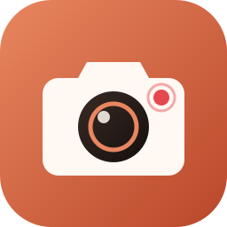

<p align="center">
  
</p>

<h1 align="center">Claude Camera</h1>

<p align="center">
  <b>Show Claude what your iPhone camera sees.</b><br>
  Snap a photo, pick one from your library, or stream a live view, and let Claude look at it.
</p>

<p align="center">
  
  
  
  
</p>

---

## ✨ What you can do

- 📷 **Take a photo** on your iPhone and ask Claude *"what do you see?"*
- 🖼️ **Send photos from your library**, several at once, with an optional note (e.g. *"read this receipt"*)
- 🔴 **Live view**: the page sends a frame every 3, 5 or 10 seconds and Claude describes what you're pointing at right now
- 💻 **From your Mac**: use your iPhone as a webcam (Continuity Camera) and shoot from there

## ⚙️ How it works

The skill has two parts:

| File | What it does |
|---|---|
| `camera-live-view/SKILL.md` | Instructions for Claude: how to create the page, where to find photos, how to look at them |
| `camera-live-view/assets/iphone-camera.html` | The "iPhone Camera" page you open on your phone |

How a photo travels:

```
iPhone                        claude.ai (private)                 Claude
──────                        ───────────────────                 ──────
📷 Take photo  ──upload──▶    "iPhone Camera" page
                              ├─ assets: the JPG file
                              └─ database: row in "photos"   ◀── reads new photos,
                                                                  downloads and views them
```

1. **First run.** Claude publishes `iphone-camera.html` as a private *artifact* in your claude.ai account, with three capabilities: `assets` (store files), `db` (a small database) and `user` (who took the photo).
2. **You shoot.** Open the page on your iPhone and tap *Take photo*. The photo is resized to max 1600 px, uploaded to the page's assets and logged in the `photos` collection (`assetId`, time, note, `seen: false`).
3. **Claude looks.** When you ask *"what do you see?"*, Claude reads the newest unseen photos, downloads the image, describes it and marks it as seen (`seen: true`).
4. **Live view.** *Start live* uses the browser camera and saves each frame to the `live/current` document. Every new frame replaces the previous one, so storage never fills up.

Everything stays in **your** private page: no external server.

## 📦 Installation

1. Download this repository (**Code → Download ZIP**) and unzip it.
2. Compress the `camera-live-view` folder into a ZIP (on Mac: right-click → *Compress*). The ZIP must contain the folder with `SKILL.md` inside.
3. On claude.ai go to **Customize → Skills**, click **+** → **Create skill** → **Upload a skill** and choose the ZIP.
4. Turn the skill on.

Requirements: a claude.ai account with skills and published artifacts enabled (e.g. Claude desktop / Cowork).

## 🚀 Usage

1. Tell Claude: *"I want to send you a photo from my iPhone"*.
2. The first time, Claude creates the **iPhone Camera** page and asks you to open it on your phone. On a Mac the page shows a **QR code** to scan with your iPhone; you can also find it among your artifacts in the Claude iPhone app.
3. On your iPhone tap **📷 Take photo** (or **🖼️ Choose from library**).
4. Go back to the chat and ask **"what do you see?"**.

For live view: tap **▶︎ Start live**, then ask Claude *"what do you see now?"* as often as you like. Tap **■ Stop live** when you're done.

## ❓ FAQ

**On my Mac, "Take photo" opens Finder.**
That's expected: the button uses the camera of the device the page is open on. Open it on your iPhone (QR code), or use live view and pick your iPhone as the camera.

**Live view doesn't start.**
Some browsers block the live camera inside claude.ai. *Take photo* always works.

**HEIC photos fail.**
On iPhone: *Settings → Camera → Formats → Most Compatible*.

**Can I share my page with others?**
Better not: their photos would land in your page. Share the skill instead; everyone gets their own page on first run.

## 🔒 Privacy

- The page is private: only you can see it unless you share it.
- Claude tells you before asking you to turn a camera on and never takes photos on its own.
- Photos are only deleted when you ask.

## 🧰 Alternatives built into the skill

- Attach a photo directly in the Claude iPhone app (**+ → Camera**).
- On macOS from a terminal (e.g. Claude Code): `brew install imagesnap` then `imagesnap -w 1.5 photo.jpg`.

## 📄 License

[MIT](LICENSE)

<sub>Community project, not affiliated with Anthropic.</sub>
